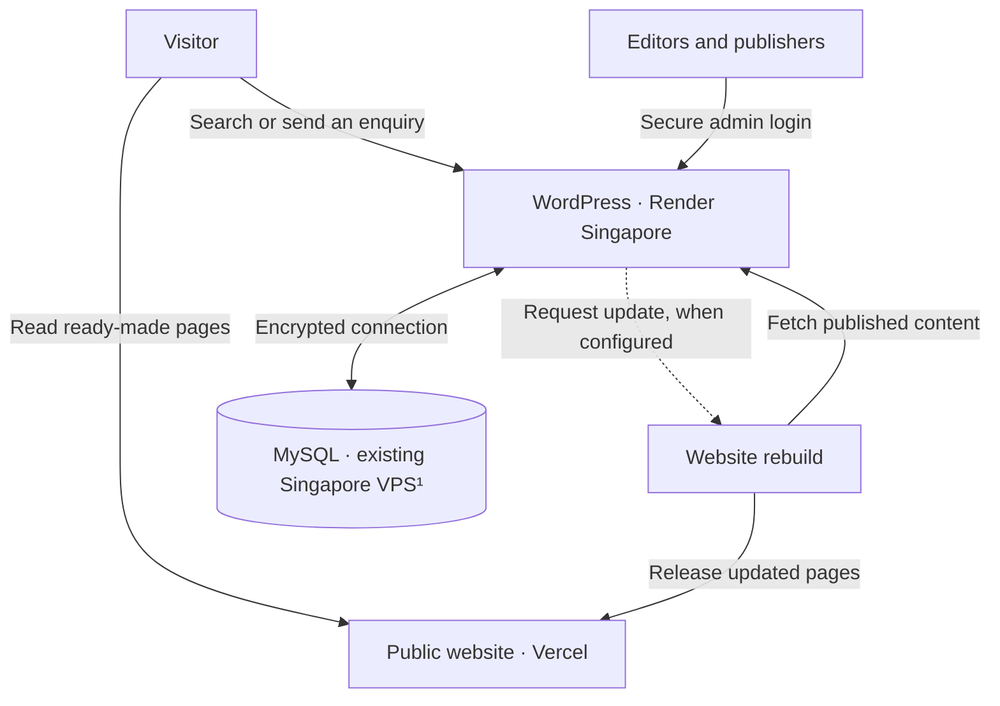
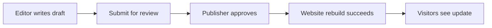

# CareConnect: taking the directory to production

**Planning brief:** 20,000 monthly visits · five editors · data kept in Singapore.  
**Reviewed:** 28 October 2026. This concise design separates existing features from proposed production work. The owner reports that the three hosted services are running; private settings and recovery arrangements have not been independently audited.

## 1. Architecture — how visitors reach the content

CareConnect combines a Next.js public website, a WordPress editing area and a MySQL database holding content, accounts and private enquiries. The **CareConnect Services** plugin supplies the directory features.

¹ A VPS is a rented server. Confirm its Singapore location in the hosting account.

**Visitor journey:** reading a page usually needs only the public website. Search asks WordPress for published results. Enquiries are stored privately before email is attempted; demo email is best-effort. Visitors never access the database directly. Existing pages can remain readable during a WordPress outage, while search and enquiries fail.

**Content updates:** saving changes updates the database immediately; public pages change after a successful rebuild. The plugin can request this through a configured Vercel deployment link. Recent testing found updated WordPress content without a new deployment, so this connection needs confirmation. The build command, `npm run build`, clears saved content responses before generating pages.

**CMS choice:** WordPress offers familiar editing, draft review and individual permissions, with directory rules kept together in the plugin. **Sanity was rejected** because it would replace the required WordPress editing experience and require a different integration.

## 2. Content model — what the team manages

| Content         | Main fields                                                                                                                                                                         |
| --------------- | ----------------------------------------------------------------------------------------------------------------------------------------------------------------------------------- |
| Service         | Name, type, short introduction, full description, eligibility, address, phone, hours, image link/alternative text, review date, up to three related services, optional map location |
| Article         | Title, summary, full text, category, publication date, image link/alternative text                                                                                                  |
| Home page       | Heading, supporting sentence, ordered featured services; latest articles appear automatically                                                                                       |
| Private enquiry | Sender name, email and message; administrators only                                                                                                                                 |

Short introductions and full descriptions are separate fields. Required-field checks keep invalid services as drafts. Reviews older than twelve months are flagged. Images use links or bundled illustrations; uploads are disabled because demo file storage is temporary.

Give the five editors individual accounts. Editors manage their own unpublished work; designated publishers review, publish and maintain home content. Administrators manage settings and private enquiries. Drafts are excluded from public responses. Previously published pages can remain visible until the website is rebuilt.

## 3. Hosting — locations, environments and releases

**Current:** Vercel serves public pages, Render's configuration selects Singapore for WordPress, and an existing VPS hosts MySQL. Local development uses Docker. Separate staging and automated release checks remain proposed.

**Residency gap:** Vercel caches pages globally, so the current setup cannot promise every hosted copy stays in Singapore. Selecting a Singapore function region would not change this static website's delivery. See [Vercel's delivery-network documentation](https://vercel.com/docs/cdn).

**Production proposal:** retain the application and content model; use paid, always-on Render WordPress in Singapore, dedicated MySQL and static-website servers in DigitalOcean Singapore (`sgp1`), and encrypted Singapore backup storage. Replace the Vercel-specific trigger with a reliable Singapore build job. These changes are not implemented. Singapore is available on [Render](https://render.com/docs/regions) and [DigitalOcean](https://docs.digitalocean.com/platform/regional-availability/).

Keep content-bearing builds, logs and backups in Singapore. Verify provider support access, email processing and backup locations before approval. Disable external maps and unapproved image hosts pending review. This scope covers provider-held copies; visitors still receive requested public pages.

| Environment | Purpose and separation                                                               |
| ----------- | ------------------------------------------------------------------------------------ |
| Development | Local Docker, fictional data, no production enquiries                                |
| Staging     | Private Singapore test site; separate database, accounts, secrets and update trigger |
| Production  | Live Singapore services, restricted access, scheduled backups                        |

**Proposed release path:** Git change → automated checks → packaged WordPress release and website build → staging review → approved production release. Build live content on a Singapore worker. Retain previous releases for rollback without overwriting newer enquiries. Currently, Render uses the repository's Docker configuration; Vercel builds from `web/` with `npm run build`.

## 4. Security — protecting visitors and the team

| Area                               | Existing protection                                                                                                                                    | Production addition                                                                                           |
| ---------------------------------- | ------------------------------------------------------------------------------------------------------------------------------------------------------ | ------------------------------------------------------------------------------------------------------------- |
| Connections                        | HTTPS hosting; supplied setup configures database encryption                                                                                           | Verify live controls and database certificate identity; restrict database access to approved servers          |
| Admin                              | Separate editor, publisher and administrator permissions                                                                                               | MFA: a second login check; remove demo access and protect the admin entrance                                  |
| Malicious content and forged edits | Validate entries, limit formatting, safely display text, use WordPress's structured database queries, check editing permissions and verify admin forms | Maintain security updates and repeat access checks after releases                                             |
| Spam and automated attacks         | Hidden bot field, timing checks, submission and size limits                                                                                            | Login throttling, firewall rules and flood protection; verify visitor-address handling behind hosting proxies |
| Secrets and backups                | Passwords and deployment links stay outside public code                                                                                                | Rotate credentials; encrypt backups with separately restricted access                                         |

Logs must omit enquiry text, emails and secrets. Agree retention before launch; a starting proposal is 90 days for enquiries and 30 days for logs. Backup expiry and deletion procedures must follow that policy.

## 5. Operations — detecting problems and recovering

Assign a technical owner and backup contact. Check pages and search every five minutes. Alert on sustained failures, low database memory/disk space, failed backups, failed rebuilds and email errors. Verify enquiry storage using controlled fictional submissions and cleanup. Keep restricted troubleshooting logs in Singapore.

Take an encrypted, consistent database backup nightly and before risky changes. Retain 30 daily copies in separate Singapore storage, plus versioned application releases and website exports. Check completion daily; practise restoration quarterly in isolation.

| Proposed target   | Client meaning                                                    |
| ----------------- | ----------------------------------------------------------------- |
| **RPO: 24 hours** | A major failure could lose up to one day of edits and enquiries   |
| **RTO: 4 hours**  | Aim to restore service within four hours of declaring an incident |

Restore the database and compatible application, check accounts and private-content protection, rebuild pages, then test search and enquiries. These targets are not demonstrated guarantees: they require an available responder. A Singapore-wide outage may take longer because overseas recovery copies are excluded.

## 6. Cost — estimated monthly budget

**Estimates, verify; USD/month.** Assume 20,000 visits, four pages per visit and 0.5 MB per page: approximately 40 GB of public delivery. Allow five WordPress accounts, modest storage, one production instance per component and one staging server. Peak capacity still needs testing.

| Item                                          | Monthly allowance |
| --------------------------------------------- | ----------------: |
| Singapore public-website server, 1 GB memory  |                $6 |
| Always-on Render WordPress, 2 GB memory       |               $25 |
| Dedicated Singapore MySQL server, 2 GB memory |               $12 |
| Separate staging server, 2 GB memory          |               $12 |
| Singapore backup storage                      |                $5 |
| Monitoring, email and usage contingency       |             $5–20 |
| **Estimated total**                           |        **$65–80** |

Baselines checked on 28 October 2026: [DigitalOcean servers](https://www.digitalocean.com/pricing/droplets), [Render](https://render.com/pricing), [backup storage](https://www.digitalocean.com/pricing/spaces-object-storage). The contingency is a planning allowance. Backup storage must be private with global delivery disabled. Excludes tax, domains, engineering/on-call labour and redundant standby servers. Editor accounts do not require five hosting-dashboard seats. The current demo uses free tiers plus an existing VPS; its bill has not been reviewed.

## 7. Risks and next steps — another working week

The shared 1 GB VPS has already experienced a MySQL memory failure. Free Render services can sleep. Failed rebuilds leave old information visible; rapid edits within the plugin's one-minute trigger window can be skipped without a retry queue. Live search may find services before their pages are rebuilt. Urgent withdrawals need an explicit removal process.

| When     | Deliverable                                                                                                                 |
| -------- | --------------------------------------------------------------------------------------------------------------------------- |
| Days 1–2 | Confirm residency and provider terms; provision staging and dedicated capacity; enable MFA and verified database encryption |
| Days 3–4 | Add monitored, retryable publishing; rehearse urgent withdrawal; schedule backups and demonstrate restoration               |
| Day 5    | Test peak traffic, editorial roles and enquiries; review alerts, retention and release checks with the client               |

A second language, image uploads, guaranteed email delivery and automatic failover remain outside the implemented scope. Approve production after evidence of a successful publishing cycle, recovery drill and residency review.
